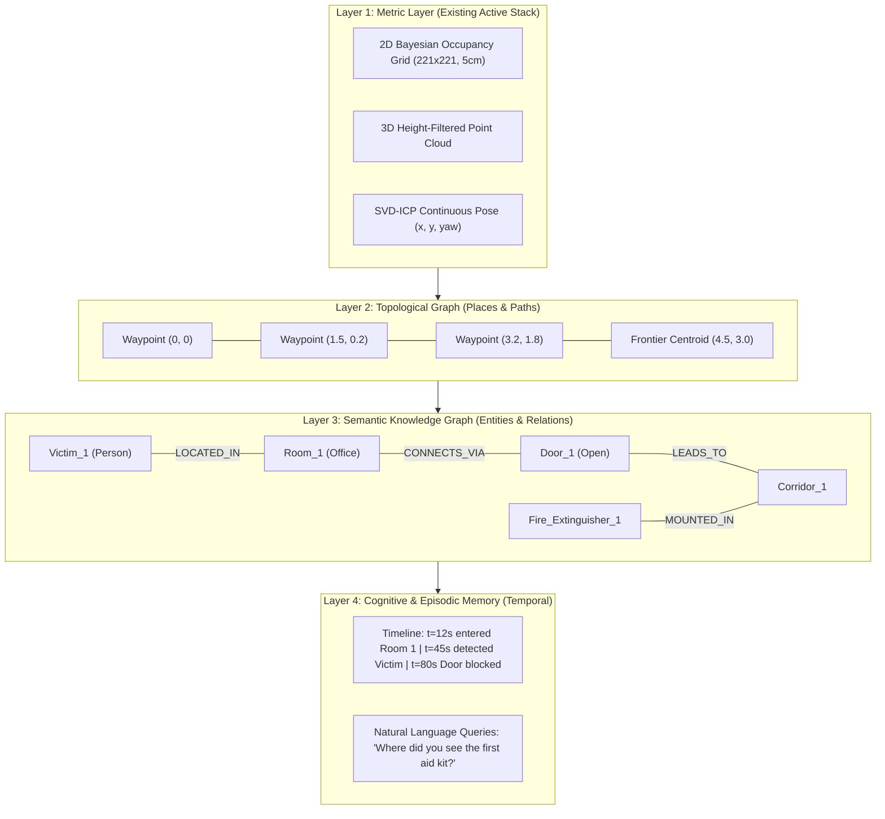

# AI, Spatial Knowledge Graphs & Robotic Memory: Architecture & Implementation Plan

---

## 1. Executive Vision: Elevating the Quadruped from Geometric to Cognitive SLAM

Currently, the quadruped robot operates in **purely geometric metric space**:
* It knows where 3D obstacles are located ($X, Y, Z$).
* It knows where empty traversable cells are ($0.05\text{m}$ grid).
* It plans collision-free paths using $A^*$.

**What is missing:** The robot has zero **semantic understanding** and zero **episodic memory**:
* It cannot distinguish a door from a wall, or a human victim from a cupboard.
* It does not understand room topology (*"I am inside Room 1, which connects via Door A to the Main Hallway"*).
* It cannot answer queries (*"Where did you see the fire extinguisher?"* or *"Have you inspected the office yet?"*).

By integrating **Semantic Vision (YOLOv8)**, a **Spatial-Temporal Knowledge Graph (3D Scene Graph)**, and an **Episodic Memory Engine**, we transform the robot into an **intelligent cognitive agent**.

---

## 2. Can We Add Knowledge Graphs and Memory to the Robot?

**Yes, absolutely.** In fact, this is the frontier of modern autonomous robotics (similar to MIT's *Hydra* and Stanford's *ConceptGraphs*). 

Robotic memory is organized into a **4-Layer Hierarchical Graph**:



### The 4 Memory Layers Explained:
1. **Layer 1: Metric Spatial Memory (Already Built)**:
   * Occupancy Grid ($221 \times 221$, $5\text{cm}$ resolution) + 3D coordinate point clouds.
2. **Layer 2: Topological Memory (Places & Navigation Graph)**:
   * A graph of traversable nodes connected by collision-free edges (extracted from $A^*$ path history and frontier visits).
3. **Layer 3: Semantic Knowledge Graph (Scene Graph)**:
   * Nodes: `Objects` (Door, Person, Chair, Box), `Regions` (Room 1, Corridor, Hallway).
   * Edges: `[Object] --LOCATED_IN--> [Room]`, `[Room_1] --CONNECTED_TO--> [Room_2] VIA [Door_X]`.
4. **Layer 4: Episodic / Temporal Memory (Event History)**:
   * Time-stamped event log: Stores changes in state over time (*"Door_1 was observed closed at $t=30\text{s}$, but found open at $t=95\text{s}$"*).

---

## 3. Detailed Component Architecture

### Component 1: Semantic Perception Engine (`semantic_detector.py`)
* **Model:** Ultralytics YOLOv8-Nano (or MobileNet-SSD) running on CPU/GPU.
* **Input:** $128 \times 128$ RGB frames from `grab_rgb_frame()`.
* **3D Localization:**
  * For bounding box with center pixel $(u_c, v_c)$, extract corresponding depth $d(u_c, v_c)$ from the existing depth matrix.
  * Project into world coordinates $(x_w, y_w, z_w)$ using pinhole intrinsics and camera pose.
* **Tracking & Persistence:**
  * Distance clustering: Detections within $0.4\text{m}$ Euclidean distance of an existing object update its observation count and confidence rather than creating duplicate nodes.

### Component 2: Spatial Knowledge Graph Engine (`knowledge_graph.py`)
* **Storage:** Lightweight in-memory graph (using `networkx` or standard Python adjacency dictionaries, serialized to JSON / SQLite).
* **Node Types:**
  * `EntityNode`: `id`, `class_name` (`"person"`, `"door"`, `"chair"`), `world_pos: (x, y, z)`, `confidence`, `first_seen_t`, `last_seen_t`.
  * `RegionNode`: `id`, `name` (`"Room_A"`, `"Corridor"`), `polygon_bounds`, `centroid`.
  * `FrontierNode`: Current unvisited boundary clusters.
* **Edge Relationships:**
  * `INSIDE(object_id, region_id)`
  * `CONNECTED_TO(region_1, region_2, via_door_id)`
  * `OBSERVED_FROM(object_id, robot_waypoint_id)`

### Component 3: Episodic Memory Logger (`episodic_memory.py`)
* Logs significant chronological events during the mission:
  ```json
  [
    {"timestamp": 14.2, "event": "ENTERED_REGION", "region": "Room_1", "pose": [1.2, 0.4]},
    {"timestamp": 28.5, "event": "OBJECT_DISCOVERED", "class": "fire_extinguisher", "pos": [2.4, 1.8]},
    {"timestamp": 62.0, "event": "FRONTIER_CLEARED", "cluster_id": 4},
    {"timestamp": 115.8, "event": "TARGET_REACHED", "goal": "Room_2_exit"}
  ]
  ```

### Component 4: VLM / LLM Query & Reasoning Agent (`cognitive_agent.py`)
* Connects the Knowledge Graph to an LLM / VLM (e.g. Gemini / local small model).
* Converts natural language user commands into structured graph queries and navigation targets:
  * **User:** *"Go to the room where you saw the person."*
  * **Agent:** Queries Knowledge Graph $\rightarrow$ finds `Victim_1` in `Room_1` at $(1.8, 2.5)$ $\rightarrow$ passes coordinate to $A^*$ planner.
  * **User:** *"Give me a situation report."*
  * **Agent:** Reads Knowledge Graph & Episodic Memory $\rightarrow$ summarizes explored rooms, detected objects, and open frontiers.

---

## 4. Proposed Phased Implementation Roadmap

### Phase 1: Semantic Perception & 3D Object Tagging
- [x] Integrate `ultralytics` YOLOv8-Nano.
- [x] Hook RGB stream into detector in `sensors.py`.
- [x] De-project 2D bounding boxes to 3D world coordinates using depth matrix.
- [x] Render detected objects as color-coded icons/markers on the OpenCV HUD in `viz.py`.

### Phase 2: Spatial Knowledge Graph & Room Segmentation
- [ ] Implement `knowledge_graph.py` with entity tracking and spatial clustering.
- [ ] Implement topological room/corridor segmentation based on doorway bottlenecks.
- [ ] Render the live Knowledge Graph overlay (nodes and connectivity edges) alongside the occupancy grid.

### Phase 3: Episodic Memory & Semantic Query Interface
- [ ] Implement `episodic_memory.py` recording mission events with timestamps.
- [ ] Implement a query interface (`query_memory("where is the victim?")`).
- [ ] Export graph and episodic log to JSON / interactive HTML visualization upon mission completion.

### Phase 4: VLM Natural Language Mission Control
- [ ] Connect Knowledge Graph context to LLM/VLM for goal-directed frontier exploration.
- [ ] Allow human operators to steer autonomous exploration using voice/text prompts.

---

## 5. Verification Plan

### Automated Unit & Integration Tests
* **Object Projection Test:** Pass known test depth frames and 2D bounding boxes; verify output $(x, y, z)$ matches ground truth coordinates within $\pm 5\text{cm}$.
* **Graph Deduplication Test:** Feed 10 consecutive detections of the same stationary object; verify the Knowledge Graph retains exactly 1 node with updated confidence.
* **Topological Query Test:** Query `get_objects_in_room("Room_1")` and verify correct entity list.

### Simulation Verification in CoppeliaSim
* Launch `main.py` with the Lizard robot in `robot_working.ttt`.
* Confirm that as the robot walks through doors and past objects (tables, chairs, cupboards), the HUD displays:
  1. Bounding box detections on the RGB feed.
  2. Labeled object markers at exact coordinates on the 2D SLAM grid.
  3. Knowledge graph nodes generated in real-time in console logs.
