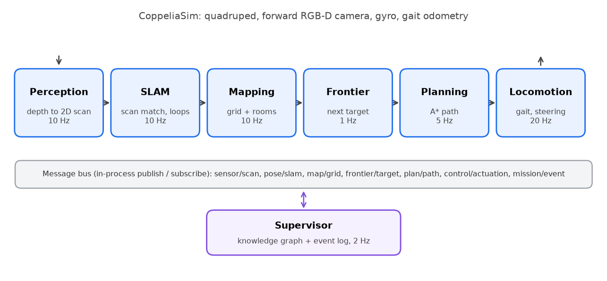
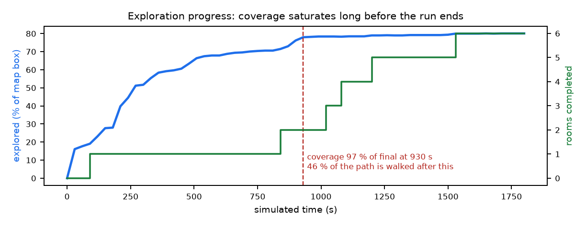
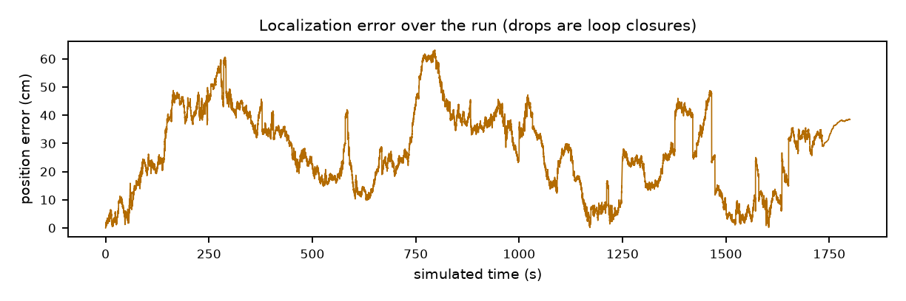
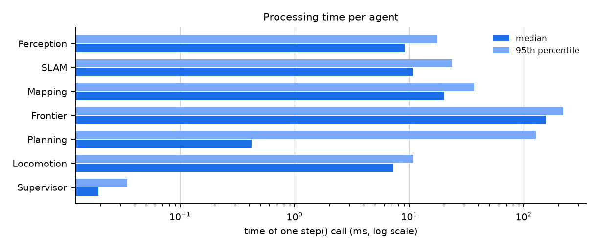
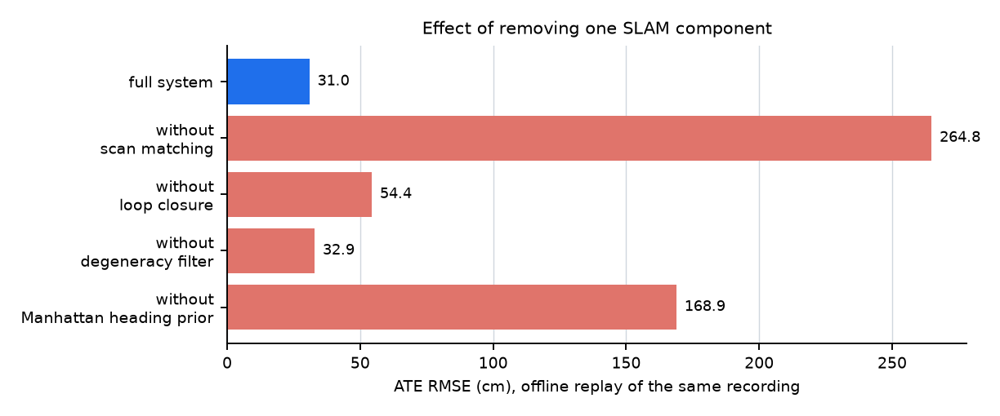
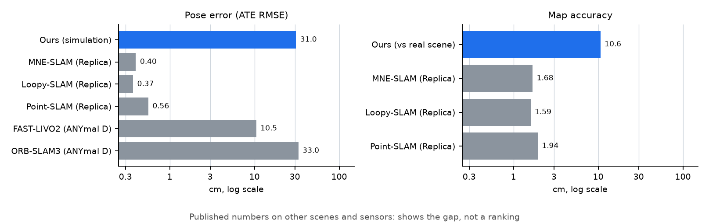

# Autonomous Quadruped Multi-Agent SLAM and Exploration

A legged robot that explores an unknown building on its own. It works out where it is, builds a map, finds rooms and doors, decides where to go next and walks there, using only a depth camera, a gyro and its own leg motion, on a normal CPU with no GPU. It runs in the CoppeliaSim simulator and is built from seven cooperating software agents.

This repository also contains a **measurement framework** that evaluates the system honestly: every number in this README is computed from a recorded run and scored against the simulator's ground truth.

> **Demo video:** [Watch the demo](PASTE_GOOGLE_DRIVE_LINK_HERE)
> **Full report:** [`PROJECT_REPORT.pdf`](docs/results/PROJECT_REPORT.pdf) (20 pages) or the editable Word version [`PROJECT_REPORT.docx`](docs/results/PROJECT_REPORT.docx) | **Results to share:** [`docs/results/RESULTS.pdf`](docs/results/RESULTS.pdf)

<p align="center"></p>
<p align="center"><em>Left: the map the robot built in one 30-minute run (true path blue, estimated path orange, unexplored boundaries red). Right: the same scene mapped with the true position, for reference.</em></p>

---

## Quick start

```powershell
pip install -r requirements.txt
```
1. Open **CoppeliaSim EDU 4.5+** and load `scene/robot_working.ttt` (do not press play; the script starts the simulation).
2. Run these from the repository root:

| Step | Command | What you get |
|---|---|---|
| 1. Run the robot | `python main_agentic.py` | The robot explores; a summary is printed and a folder `runs/<run_id>/` is saved with a full report |
| 2. Find out which parts matter | `python -m evaluation.ablate runs/<run_id>` | Replays the run with one SLAM component removed at a time |
| 3. Build the results PDF | `python -m evaluation.results_pdf runs/<run_id>` | A shareable PDF of results and comparison with published systems |

More commands are listed under [Extra commands](#extra-commands).

---

## What problem does this solve?

Sending a person first into an unknown or dangerous indoor space (a hostage situation, a crime scene, a collapsed building) is risky and can disturb evidence. A small robot can go first, but it must manage **without GPS, without a map and without an operator**: it has to find out where it is while it builds the map (this is called SLAM, simultaneous localization and mapping), decide what to explore next, and avoid obstacles, on a small low-power computer.

This project is the **Sense and Navigate** part of a seven-stage first-response pipeline (sense, navigate, trigger, perceive, decide, store, sync) from course project 23CSE399. The later stages are listed in the [roadmap](#roadmap).

## What does the robot do?

1. **Looks** forward with a depth camera and turns the picture into a 2D outline of the obstacles around it.
2. **Works out where it is** by matching each new outline with the previous one, combined with how far its legs say it moved and what its gyro says about turning.
3. **Maps** the space: free floor, walls and unknown areas.
4. **Finds rooms and doorways** in the map.
5. **Chooses** the most useful unexplored boundary to visit next, one room at a time, moving between rooms through doorways.
6. **Plans** a path around obstacles and **walks** it with a four-legged gait, recovering if it gets stuck.
7. **Stops** when no reachable unexplored space is left, and keeps a record of rooms, doorways and objects.

**Input:** depth and colour images, gait odometry, gyro. **Output:** robot pose, occupancy map, rooms and doorways, exploration path, walking commands, a knowledge graph and a log of events.

## Architecture

<p align="center"></p>

The seven agents run in one Python process. Each simulation step the main loop calls them in order at their own rates; they exchange messages over an in-process publish/subscribe bus. The SLAM, mapping, perception, frontier and planning code and the odometry never call the simulator's robot-pose functions (checked automatically by `evaluation/audit.py`).

> The agents are well-separated software modules, not parallel processes. They run one after another in a single thread, and no robotics framework (such as ROS 2) is used.

## The agents

| Agent | Rate | What it does |
|---|---|---|
| **Perception** | 10 Hz | Reads the camera, converts depth into 3D points in the robot's own frame, ignores points on the robot's body, and outputs a 2D obstacle scan (height 4–60 cm). |
| **SLAM** | 10 Hz | Estimates the robot's position and heading by scan matching seeded with odometry; the gyro leads the heading and a wall-direction rule corrects its drift; recognizes revisited places and corrects accumulated error. |
| **Mapping** | 10 Hz | Builds a probabilistic occupancy grid (220 × 220 cells of 5 cm), splits it into rooms, finds doorways and labels obstacle blobs. |
| **Frontier** | 1 Hz | Finds the boundary between known and unknown space and picks the next target by walking distance and information gain; sweeps room by room; decides when exploration is done. |
| **Planning** | 5 Hz | Plans a collision-free A* path over known free space with a 15 cm safety margin and smooths it. |
| **Locomotion** | 20 Hz | Generates the walking gait, steers to the next waypoint, detects when the robot is stuck or not making progress and recovers, and reports odometry and gyro. |
| **Supervisor** | 2 Hz | Keeps a knowledge graph (rooms, doorways, objects) and a timeline of mission events. |

## Main components

| Component | Where | Purpose |
|---|---|---|
| Scan-matching SLAM | `core/slam.py` | Point-to-line ICP, degeneracy filter, Manhattan heading prior, keyframe loop closure |
| Occupancy grid | `core/grid.py` | Log-odds map, frontier detection |
| Path planner | `core/planner.py` | A* with clearance margin and smoothing |
| Robot and gait | `core/robot.py` | Walking gait, steering, calibrated odometry, simulated gyro |
| Sensors | `core/sensors.py` | Camera model and depth back-projection |
| Telemetry | `evaluation/run_telemetry.py` | Per-run metrics, timing of every agent, run manifest |
| Scoring | `evaluation/truth_eval.py`, `accuracy_evaluator.py` | Scores pose, map and objects against ground truth and the real scene geometry |
| Offline replay and ablation | `evaluation/slam_replay.py`, `ablate.py` | Re-runs SLAM on recorded data to measure each component |
| Integrity audit | `evaluation/audit.py` | Checks that no ground truth leaks into the estimator |
| Reports and figures | `evaluation/report.py`, `results_pdf.py`, `baseline_pdf.py`, `project_report.py`, `make_figures.py` | Automatic reports and PDFs |

---

## Results (baseline)

One run of 1800 simulated seconds in a 10 m × 10 m, 8-room arena with 13 objects (`scene/robot_working.ttt`). All tables with a one-line definition of every value are in [`RESULTS.pdf`](docs/results/RESULTS.pdf).

| Area | Result |
|---|---|
| **Exploration** | **Not completed**: stopped at the time limit with 6 of 8 rooms done; 157.9 m travelled at 0.088 m/s; 88% of the real floor mapped |
| **Localization** | Position error 31.0 cm RMSE (0.20% of the path); final drift 0.24% of the path; heading error 0.74°; 68 loop closures; never above 63 cm |
| **Mapping** | Accuracy 10.6 cm and completion 9.2 cm against the real walls; precision 74%, recall 82%, F1 78% |
| **Cost** | SLAM update 10.6 ms, map update 20.3 ms, map size 0.19 MB; 86% of one CPU core; no GPU; 0.32× real time on a Ryzen 7 laptop |
| **Object detection** | 21% of detections lie on a real object: objects are labelled by blob size, not recognized |
| **Which parts matter** | Removing scan matching raises the error from 31 to 265 cm, the wall-direction prior to 169 cm, loop closure to 54 cm; the degeneracy filter changes it by 2 cm |

Of 38 classified metrics, **10 are Good, 12 can be improved and 16 are Poor** (the per-metric ratings are in the report).

### Graphs

<p align="center"> </p>
<p align="center"> </p>

## Evaluation: how we measure

- **Ground truth:** the simulator's true robot pose is recorded every 0.05 s, for scoring only.
- **Two map references:** a map built from the same camera with the true pose, and the real wall and object geometry read from the scene (independent of the robot's sensor).
- **Metrics:** position error (ATE), error per metre (RPE), drift, map accuracy/completion/precision/recall, true floor coverage, object detection precision, processing time of every agent, CPU and memory.
- **Component tests:** the recorded sensor data is replayed offline with one component removed; the live robot is never changed. Replay reproduces the live run to 0.01 cm.
- **Integrity:** an automatic audit confirms the estimator never uses ground truth.
- **Classification:** each metric is rated Good, Improve or Poor against stated limits.
- **Honesty rules:** nothing is typed in; unmeasurable values are shown as unavailable; one run claims no repeatability.

## Comparison with published systems and products

<p align="center"></p>

No published system was tested under our conditions, so none is directly comparable; the chart shows where the gap is, not a ranking.
- Against RGB-D neural SLAM on the Replica dataset we are about an order of magnitude less accurate, but use 0.19 MB of map instead of 20–31 MB and a 10.6 ms update instead of 22–69 ms.
- Our drift per path length (0.20%) is the same order as ORB-SLAM3 stereo on a real ANYmal D (derived 0.14%).
- We are slower than every compared robot (0.088 m/s against 0.75 to over 6 m/s).
- Capabilities of Spot, ANYmal, Go2, Unitree B2, DEEP Robotics X30 and Emesent Hovermap are compared in the report, together with a reference on the TUM RGB-D Pioneer sequences where our system is **yet to be run**.

## Roadmap

Nothing below is done yet; the baseline was taken first so every change can be judged against it. Details: [`docs/project/FIXES.md`](docs/project/FIXES.md).

| Phase | Work |
|---|---|
| 1. Make exploration finish | Ignore false frontiers beyond walls; stop re-visiting; end a run on completion |
| 2. Measure what is unknown | Profile where time goes; repeat runs; time to complete; a second arena |
| 3. Accuracy | Reduce local pose jitter and wall smearing |
| 4. Speed | Faster gait; remove stalls; real-time operation |
| 5. Perception | Replace the size rule with real object recognition |
| 6. External validation | Run on the TUM Pioneer dataset; head-to-head with Cartographer; hardware tests |
| 7. Full pipeline | Anomaly detection, event triggering, tamper-evident logging, synchronization, battery-aware return |

## Repository structure

```text
main_agentic.py      entry point: runs the mission and records the run
agents/              the seven agents, message bus, knowledge graph, episodic memory
core/                algorithms and simulator interface: slam, grid, planner, robot, sensors, viz
evaluation/          measurement, scoring, reports, comparison and published numbers
  data/              real scene geometry (used for scoring only)
scene/               the CoppeliaSim scene
tests/               formula and algorithm tests
runs/                one folder per measured run (the raw recording stays local)
docs/
  results/           PROJECT_REPORT.pdf and .docx, RESULTS.pdf (to share), DIAGNOSTIC_REPORT.pdf (internal)
  project/           OBJECTIVES.md, BASELINE.md, FIXES.md
  system_architecture_diagram.html   project architecture diagram (course document)
  images/            figures used in this README
```

Each run folder contains `REPORT.md`, `metrics.json`, `trajectory.csv`, `manifest.json`, `artifacts/` and the local-only `recording.npz`. The baseline run is [`runs/20261024_210638`](runs/20261024_210638/REPORT.md).

## Extra commands

| Task | Command |
|---|---|
| Run options | `python main_agentic.py --headless` (no HUD window), `--max-time S` (safety limit in simulated seconds, default 3600) |
| Score a run against the real scene | `python -m evaluation.truth_eval runs/<run_id>` (also runs automatically after a run) |
| Read the scene's wall and object geometry | `python -m evaluation.scene_truth` (simulator open, not running) |
| Rebuild a run's report | `python -m evaluation.report runs/<run_id>` |
| Internal diagnostic PDF | `python -m evaluation.baseline_pdf runs/<run_id>` |
| Full project report (PDF and Word) | `python -m evaluation.project_report runs/<run_id>` |
| Regenerate the README figures | `python -m evaluation.make_figures runs/<run_id>` |
| Replay SLAM variants on a recording | `python -m evaluation.slam_replay runs/<run_id>/recording.npz --set icp_yaw_weight=0.2` |
| Tests | `python tests/test_agents.py`, `python tests/test_slam_accuracy.py`, `python tests/test_run_telemetry.py` |

**Known limits:** results come from one simulated run; the robot turns by setting its body orientation directly (a simulation shortcut), and its gait odometry was calibrated once offline against ground truth. See the report's threats-to-validity section.
