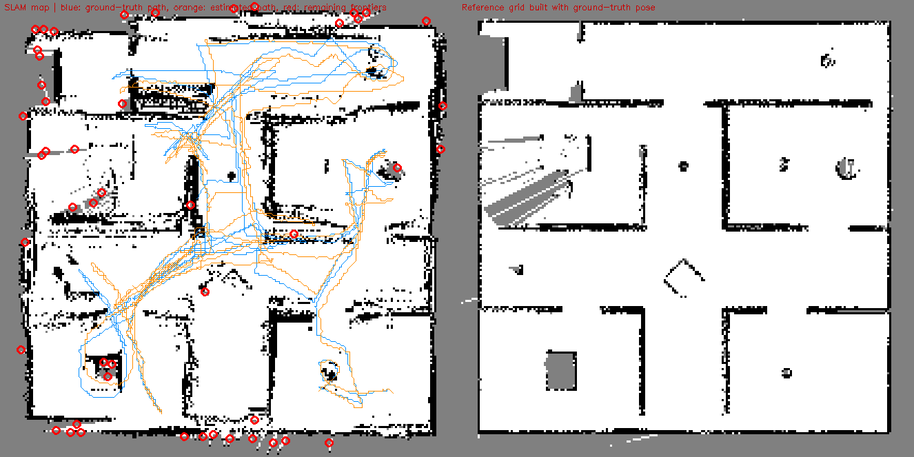

# Baseline report: run 20261024_210638

Every number comes from this run's own files. Measured = computed from telemetry or ground truth; estimate / diagnostic indicator are labelled as such; n/a = could not be measured (reason shown).

## Run identification

| Item | Value |
|---|---|
| Started | 2026-10-24T21:06:38 |
| Command | `main_agentic.py --max-time 1800` |
| Code | git 1f231d2 (+ uncommitted changes at run time) |
| CPU / GPU | AMD Ryzen 7 7735HS with Radeon Graphics (16 threads) / NVIDIA GeForce RTX 3050 6GB Laptop GPU, 6144 MiB |
| Platform | Windows-11-10.0.26200-SP0, Python 3.12.10 |
| Configuration | `{"max_time_s": 1800.0, "max_steps": null, "grid_res_m": 0.05, "map_bounds_m": [-5.5, 5.5, -5.5, 5.5], "ground_truth_nav": false, "headless": false, "agent_rates_hz": {"PerceptionAgent": 10.0, "SLAMAgent": 10.0, "MappingAgent": 10.0, "FrontierAgent": 1.0, "PlanningAgent": 5.0, "LocomotionAgent": 20.0, "SupervisorAgent": 2.0}}` |
| Ground truth | CoppeliaSim /Base pose every control step (used for scoring only) |
| Runs in this report | 1 (no variability can be shown) |

| Source data | File | Detail |
|---|---|---|
| raw SLAM input recording | recording.npz | 350 MB, sha256 321fdb51f4d679ac... |
| per-step ground-truth and estimated pose | trajectory.csv |  |
| agent table | agents.csv |  |
| all metrics | metrics.json |  |
| run manifest | manifest.json |  |
| ablation (offline replay) | ablation.csv |  |
| reference/SLAM grids, knowledge graph | artifacts |  |

## 1. Overall robot performance: what the robot achieved

| Metric | Value | Meaning |
|---|---|---|
| Outcome | timeout (1800s) before all frontiers were cleared | why the run ended |
| Task success | no | mission reported all reachable frontiers explored |
| Simulated time | 1800 s | robot time |
| Wall-clock time | 5666 s (real-time factor 0.32) | how long the computer needed; < 1 means slower than real time |
| Distance travelled | 157.9 m | path length from ground truth |
| Average speed | 0.088 m/s | distance / simulated time |
| Rooms completed / discovered | 6 / 8 | rooms the mapper segmented |
| Doorways detected | 17 | knowledge-graph entries; they accumulate as room segmentation changes, so this over-counts real doorways |
| Explored free area | 84.3 m2 | free cells x 0.05 m x 0.05 m |
| Grid observed | 80.1 % | of the 11 x 11 m map box, not of the arena |
| Stuck events / unreachable targets | 4 / 9 | watchdog and planner events |
| Human interventions | n/a (no intervention channel exists in the stack; only the 'q' key / external stop, recorded in end_reason) |  |
| Collisions | n/a (CoppeliaSim contact sensing is not wired into the stack) |  |

## 2. Agent and component performance

### 2a. Operational performance (how the agents ran, not whether they helped)

| Agent | Rate (Hz) | Calls | Errors | p50 (ms) | p95 (ms) | max (ms) | Total (s) | Share | Task metric |
|---|---|---|---|---|---|---|---|---|---|
| PerceptionAgent | 10 | 36001 | 0 | 9.14 | 17.43 | 1986 | 355 | 14 % | median 618 scan pts/update |
| SLAMAgent | 10 | 36001 | 0 | 10.62 | 23.64 | 85 | 440 | 17 % | 26.9% scans matched, 68 loop closures |
| MappingAgent | 10 | 36001 | 0 | 20.30 | 36.93 | 179 | 805 | 31 % | 80.1% of grid observed |
| FrontierAgent | 1 | 3601 | 0 | 155.00 | 220.89 | 577 | 556 | 21 % | 6 rooms completed |
| PlanningAgent | 5 | 7201 | 0 | 0.42 | 127.62 | 1061 | 161 | 6 % | 1814 paths, 9 unreachable |
| LocomotionAgent | 20 | 36001 | 0 | 7.25 | 10.72 | 52 | 275 | 11 % | 4 stuck/watchdog events |
| SupervisorAgent | 2 | 3601 | 0 | 0.02 | 0.03 | 0 | 0 | 0 % | 280 events logged, 8 rooms in graph |

Whole control-loop step: p50 91 ms, p95 380 ms, max 2248 ms. Agent time is 2593 s of 5666 s wall time; the rest is simulator stepping, image transfer, HUD and per-step map queries outside `agent.step()` (split not measured).

### 2b. Contribution to the system result (offline replay of this run's recording, one component removed)

| Configuration | ATE RMSE (cm) | Final error (cm) | RPE (%) | Heading err (deg) | Loop closures | Delta ATE vs full (cm) |
|---|---|---|---|---|---|---|
| full system | 31.0 | 38.5 | 7.4 | 0.74 | 68 | n/a |
| without scan matching (odometry + gyro only) | 264.8 | 135.7 | 1.8 | 44.62 | 0 | 233.9 |
| without loop closure | 54.4 | 90.1 | 6.2 | 0.71 | 0 | 23.5 |
| without degeneracy filter | 32.9 | 30.7 | 7.5 | 0.74 | 70 | 2.0 |
| without Manhattan heading prior | 168.9 | 215.9 | 7.5 | 18.78 | 71 | 138.0 |
| full system (repeat, determinism check) | 31.0 | 38.5 | 7.4 | 0.74 | 68 | 0.0 |

Replay checks: two identical replays differ by at most 0 m (determinism); the full replay differs from the live trajectory by at most 0.01 cm over 36001 steps. One recording only: differences are not statistically tested, and a component that does not change the ATE here may still matter in other conditions.

## 3. Localization performance (independent of mapping)

Frame: 2D world frame of the simulator scene (x, y in m, yaw in rad). SLAM starts at the true start pose, so no trajectory alignment is applied. Evaluated at every control step (0.05 s) against simulator ground truth.

| Metric | Value | Meaning |
|---|---|---|
| ATE RMSE | 31.0 cm | typical position error over the whole run |
| ATE median / max | 27.1 / 63.1 cm |  |
| Final position error | 38.5 cm = 0.24 % of path | end-of-run drift |
| RPE translation (1 m segments) | 9.3 cm RMSE, mean 7.4 % of segment | local accuracy, independent of accumulated drift |
| RPE rotation | 1.30 deg/m |  |
| Heading error mean / max | 0.74 / 4.9 deg |  |
| Error first above 0.5 m / 1 m | 255 s / n/a | n/a = never reached |
| Scan-match acceptance (diagnostic) | 26.9 % of 36000 updates | see warning in section 6 |
| Tracking-loss episodes (diagnostic) | 757 (548 s total) | >= 10 consecutive rejected updates |
| Followed by a loop closure within 30 s | 341 | relocalization proxy |
| Loop closures accepted | 68 |  |
| Odometry distance vs true | 134.7 m (-14.7 %) | diagnostic only: ground-truth path length also counts body motion the gait did not command, and the odometry-only replay in 2b has a low local error (RPE), so this is not a clean odometry scale error |

## 4. Mapping performance (independent of localization)

Reference = occupancy grid built from the same depth stream with the ground-truth pose (not an independent floor plan). Map size, coverage and accuracy are separate rows.

| Metric | Value | Meaning |
|---|---|---|
| Coverage: explored free area | 84.3 m2 | size of what was seen |
| Wall accuracy | 12.9 cm | SLAM walls to reference walls (lower is better) |
| Wall completion | 6.4 cm | reference walls to SLAM walls (lower is better) |
| Completion ratio (5 cm) | 54.1 % | reference wall cells matched within 5 cm |
| Chamfer / Hausdorff-95 | 9.6 / 30.2 cm |  |
| Precision / recall / F1 | 66.8 / 91.3 / 77.2 % | tolerance 15 cm |
| Free-space IoU | 81.2 % |  |
| Occupied cells SLAM / reference | 5407 / 3184 | more SLAM cells = thicker or smeared walls |
| Map update p50 / p95 | 20.3 / 36.9 ms |  |
| Map memory | 0.19 MB | occupancy grid |
| Frontiers remaining | 48 | unexplored boundaries left (see map_overlay.png) |

## 5. Computational performance

| Metric | Value |
|---|---|
| Process CPU mean / p95 | 86 / 106 % (of one core; CoppeliaSim not included) |
| Memory (RSS) mean / peak | 1037 / 2973 MB (includes the in-memory recording buffer) |
| GPU | NVIDIA GeForce RTX 3050 6GB Laptop GPU, 6144 MiB: n/a (no code path uses the GPU (NumPy/SciPy/OpenCV on CPU); nothing to attribute) |
| SLAM tracking p50 / p95 | 10.6 / 23.6 ms |
| Largest agent by total time | MappingAgent |
| Telemetry overhead (estimate) | 0.0016 ms/step, about 0.002 % of the median loop step |

## 6. Data quality and limitations

**Warnings**

- run ended by a limit (timeout (1800s) before all frontiers were cleared), not by mission completion: coverage, rooms completed and task success are lower bounds
- scan matching passed its acceptance gates on only 27 % of updates; rejection reasons are not recorded (and the flag is not refreshed for scans with <20 points), so this is a diagnostic indicator, not a failure rate

**Limitations**

- Single run: no repeatability or variance claims.
- Ground truth = CoppeliaSim body pose (exact, same timestamps; no alignment applied because SLAM starts at the GT start pose).
- Map reference = occupancy grid built from the same depth stream using the GT pose: it isolates SLAM pose error, but is limited by what the sensor saw; it is not an independent CAD floor plan.
- Simulation only: sensor noise, gait slip and lighting are simulated, not measured on hardware.

**Integrity checks** (`audit.py`)

| Check | Result | Detail |
|---|---|---|
| No ground-truth pose API in SLAM, mapping, perception, planning or odometry (static source scan) | pass | 6 files + odometry clean; gyro reads orientation delta only |
| SLAMAgent does not subscribe to pose/ground_truth in closed-loop mode | pass | subscribes to: control/actuation, sensor/scan |
| Estimated trajectory is not a copy of ground truth | pass | estimate differs from ground truth (max 63.1 cm over 36001 steps) |
| Run navigated on the SLAM pose (not ground truth) | pass | config.ground_truth_nav = False |

**Post-run corrections** (the raw `metrics.json` is unchanged)

- doorways_detected: the as-run value (0) came from a bus-event counter that never fires (doorways are logged to episodic memory); replaced by 17 from artifacts/knowledge_graph.json
- telemetry overhead: the as-run value (0.0034 ms/step) counted only the SLAM bookkeeping; recomputed as a calibrated estimate (0.0016 ms/step = timing-wrapper micro-benchmark x 158407 calls / 36001 steps)
- 2 data-quality warning(s) added after the run (the live summary now uses the same function)

**Metric definitions**

- frame: 2D world frame of the CoppeliaSim scene (x, y in m, yaw in rad, CCW); SLAM initialised at the GT start pose, no trajectory alignment
- ate: per-step Euclidean position error |p_est - p_gt| over every control step; RMSE/mean/median/max
- final_drift_pct: final position error / GT path length * 100
- rpe: distance-based relative pose error over 1.0 m GT segments, relative motion in the start body frame; trans RMSE (m), mean trans error as % of segment, rot RMSE (deg/m)
- icp_acceptance: share of SLAM updates whose scan match passed the acceptance gates (else odometry-only)
- tracking_loss_episode: >= 10 consecutive rejected SLAM updates
- relocalized: tracking-loss episode followed by an accepted loop closure within 30 s
- wall_accuracy/completion: mean distance SLAM->reference occupied cells / reference->SLAM (m)
- precision/recall/f1: occupied-cell agreement with reference grid within tolerance_m
- free_space_iou: IoU of free cells between SLAM grid and reference grid
- latency: wall-clock time of each agent.step() call (ms), p50/p95/max over all calls
- real_time_factor: simulated seconds per wall-clock second

## 7. External benchmark comparison

Not yet done: added only after these measurements are verified.
