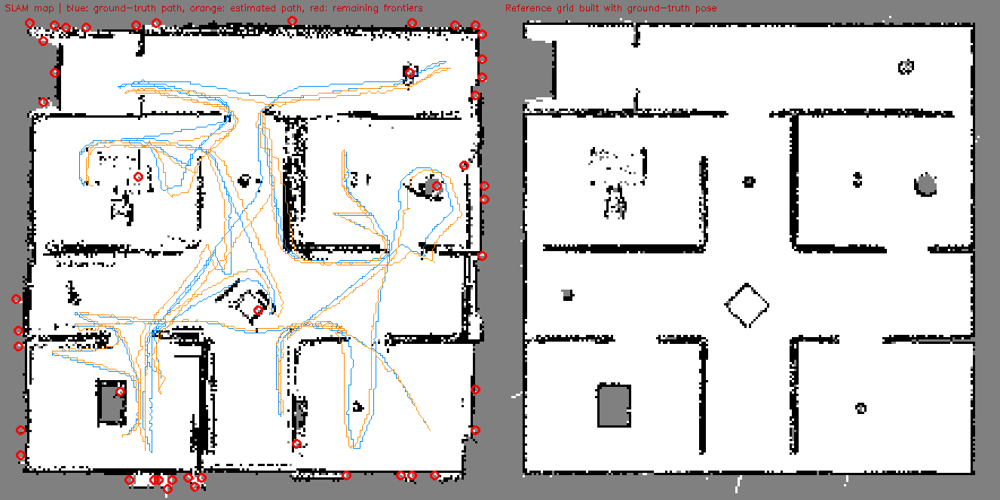

# Baseline report: run 20261107_161737

Every number comes from this run's own files. Measured = computed from telemetry or ground truth; estimate / diagnostic indicator are labelled as such; n/a = could not be measured (reason shown).

## Run identification

| Item | Value |
|---|---|
| Started | 2026-11-07T16:17:37 |
| Command | `main_agentic.py --headless` |
| Code | git b50b498 |
| CPU / GPU | AMD Ryzen 7 7735HS with Radeon Graphics (16 threads) / NVIDIA GeForce RTX 3050 6GB Laptop GPU, 6144 MiB |
| Platform | Windows-11-10.0.26300-SP0, Python 3.12.10 |
| Configuration | `{"max_time_s": 3600.0, "max_steps": null, "grid_res_m": 0.05, "map_bounds_m": [-5.5, 5.5, -5.5, 5.5], "ground_truth_nav": false, "headless": true, "agent_rates_hz": {"PerceptionAgent": 10.0, "SLAMAgent": 10.0, "MappingAgent": 10.0, "FrontierAgent": 1.0, "PlanningAgent": 5.0, "LocomotionAgent": 20.0, "SupervisorAgent": 2.0}}` |
| Ground truth | CoppeliaSim /Base pose every control step (used for scoring only) |
| Runs in this report | 1 (no variability can be shown) |

| Source data | File | Detail |
|---|---|---|
| raw SLAM input recording | recording.npz | 319 MB, sha256 886a2bffd5e9683c... |
| per-step ground-truth and estimated pose | trajectory.csv |  |
| agent table | agents.csv |  |
| all metrics | metrics.json |  |
| run manifest | manifest.json |  |
| reference/SLAM grids, knowledge graph | artifacts |  |

## 1. Overall robot performance: what the robot achieved

| Metric | Value | Meaning |
|---|---|---|
| Outcome | all reachable frontiers explored | why the run ended |
| Task success | yes | mission reported all reachable frontiers explored |
| Simulated time | 1604 s | robot time |
| Wall-clock time | 2493 s (real-time factor 0.64) | how long the computer needed; < 1 means slower than real time |
| Distance travelled | 145.5 m | path length from ground truth |
| Average speed | 0.091 m/s | distance / simulated time |
| Rooms completed / discovered | 7 / 8 | rooms the mapper segmented |
| Doorways detected | 37 | knowledge-graph entries; they accumulate as room segmentation changes, so this over-counts real doorways |
| Explored free area | 86.4 m2 | free cells x 0.05 m x 0.05 m |
| Grid observed | 79.6 % | of the 11 x 11 m map box, not of the arena |
| Stuck events / unreachable targets | 3 / 5 | watchdog and planner events |
| Human interventions | n/a (no intervention channel exists in the stack; only the 'q' key / external stop, recorded in end_reason) |  |
| Collisions | n/a (CoppeliaSim contact sensing is not wired into the stack) |  |

## 2. Agent and component performance

### 2a. Operational performance (how the agents ran, not whether they helped)

| Agent | Rate (Hz) | Calls | Errors | p50 (ms) | p95 (ms) | max (ms) | Total (s) | Share | Task metric |
|---|---|---|---|---|---|---|---|---|---|
| PerceptionAgent | 10 | 32091 | 0 | 7.20 | 15.18 | 172 | 259 | 24 % | median 651 scan pts/update |
| SLAMAgent | 10 | 32091 | 0 | 10.15 | 20.85 | 224 | 365 | 34 % | 24.1% scans matched, 73 loop closures |
| MappingAgent | 10 | 32091 | 0 | 1.33 | 7.92 | 870 | 90 | 8 % | 79.6% of grid observed |
| FrontierAgent | 1 | 3210 | 0 | 21.17 | 40.62 | 115 | 76 | 7 % | 7 rooms completed |
| PlanningAgent | 5 | 6418 | 0 | 0.27 | 37.87 | 712 | 44 | 4 % | 713 paths, 5 unreachable |
| LocomotionAgent | 20 | 32090 | 0 | 6.89 | 9.76 | 102 | 231 | 22 % | 3 stuck/watchdog events |
| SupervisorAgent | 2 | 3209 | 0 | 0.08 | 0.15 | 1 | 0 | 0 % | 247 events logged, 8 rooms in graph |

Whole control-loop step: p50 31 ms, p95 173 ms, max 1920 ms. Agent time is 1064 s of 2493 s wall time; the rest is simulator stepping, image transfer, HUD and per-step map queries outside `agent.step()` (split not measured).

### 2b. Contribution to the system result (offline replay of this run's recording, one component removed)

n/a (ablation not run: `python -m evaluation.ablate runs/<run_id>`)

## 3. Localization performance (independent of mapping)

Frame: 2D world frame of the simulator scene (x, y in m, yaw in rad). SLAM starts at the true start pose, so no trajectory alignment is applied. Evaluated at every control step (0.05 s) against simulator ground truth.

| Metric | Value | Meaning |
|---|---|---|
| ATE RMSE | 16.1 cm | typical position error over the whole run |
| ATE median / max | 14.6 / 33.2 cm |  |
| Final position error | 12.7 cm = 0.09 % of path | end-of-run drift |
| RPE translation (1 m segments) | 7.6 cm RMSE, mean 4.9 % of segment | local accuracy, independent of accumulated drift |
| RPE rotation | 1.40 deg/m |  |
| Heading error mean / max | 0.86 / 5.4 deg |  |
| Error first above 0.5 m / 1 m | n/a / n/a | n/a = never reached |
| Scan-match acceptance (diagnostic) | 24.1 % of 32090 updates | see warning in section 6 |
| Tracking-loss episodes (diagnostic) | 518 (731 s total) | >= 10 consecutive rejected updates |
| Followed by a loop closure within 30 s | 274 | relocalization proxy |
| Loop closures accepted | 73 |  |
| Odometry distance vs true | 124.1 m (-14.8 %) | diagnostic only: ground-truth path length also counts body motion the gait did not command, and the odometry-only replay in 2b has a low local error (RPE), so this is not a clean odometry scale error |

## 4. Mapping performance (independent of localization)

Reference = occupancy grid built from the same depth stream with the ground-truth pose (not an independent floor plan). Map size, coverage and accuracy are separate rows.

| Metric | Value | Meaning |
|---|---|---|
| Coverage: explored free area | 86.4 m2 | size of what was seen |
| Wall accuracy | 7.3 cm | SLAM walls to reference walls (lower is better) |
| Wall completion | 4.5 cm | reference walls to SLAM walls (lower is better) |
| Completion ratio (5 cm) | 60.4 % | reference wall cells matched within 5 cm |
| Chamfer / Hausdorff-95 | 5.9 / 20.0 cm |  |
| Precision / recall / F1 | 89.4 / 98.5 / 93.7 % | tolerance 15 cm |
| Free-space IoU | 87.2 % |  |
| Occupied cells SLAM / reference | 4345 / 3374 | more SLAM cells = thicker or smeared walls |
| Map update p50 / p95 | 1.3 / 7.9 ms |  |
| Map memory | 0.19 MB | occupancy grid |
| Frontiers remaining | 46 | unexplored boundaries left (see map_overlay.png) |

### 4b. Against the real scene (wall and object geometry read from CoppeliaSim, scoring only)

| Metric | Value | Meaning |
|---|---|---|
| Map accuracy / completion | 5.5 / 8.5 cm | mapped obstacle cells to real ones / real to mapped (mean) |
| Map precision / recall / F1 | 91.6 / 85.9 / 88.7 % | within 15 cm of a real wall or object |
| Same, map built with the true pose | accuracy 0.2 cm, recall 91.3 % | what the sensor allows with perfect localization |
| Real floor mapped as free | 92.9 % of 85.2 m2 | true coverage |
| Free space mapped outside the arena | 0.40 m2 | impossible in reality; source of phantom frontiers |
| Object detections on a real object | 22 of 94 (23.4 %) | within 0.5 m of one of 13 real objects |
| Real objects with a detection nearby | 13 of 13 | inflated by the many scattered detections |
| 'Chair' labels on the real chair | 1 of 94 (scene has 1 chair) | chair label = blob 0.18-1.05 m across |

## 5. Computational performance

| Metric | Value |
|---|---|
| Process CPU mean / p95 | 67 / 86 % (of one core; CoppeliaSim not included) |
| Memory (RSS) mean / peak | 1008 / 2585 MB (includes the in-memory recording buffer) |
| GPU | NVIDIA GeForce RTX 3050 6GB Laptop GPU, 6144 MiB: n/a (no code path uses the GPU (NumPy/SciPy/OpenCV on CPU); nothing to attribute) |
| SLAM tracking p50 / p95 | 10.1 / 20.9 ms |
| Largest agent by total time | SLAMAgent |
| Telemetry overhead (estimate) | 0.0051 ms/step, about 0.016 % of the median loop step |

## 6. Data quality and limitations

**Warnings**

- scan matching passed its acceptance gates on only 24 % of updates; rejection reasons are not recorded (and the flag is not refreshed for scans with <20 points), so this is a diagnostic indicator, not a failure rate

**Limitations**

- Single run: no repeatability or variance claims.
- Ground truth = CoppeliaSim body pose (exact, same timestamps; no alignment applied because SLAM starts at the GT start pose).
- Map reference = occupancy grid built from the same depth stream using the GT pose: it isolates SLAM pose error, but is limited by what the sensor saw; it is not an independent CAD floor plan.
- Simulation only: sensor noise, gait slip and lighting are simulated, not measured on hardware.

**Integrity checks** (`audit.py`)

| Check | Result | Detail |
|---|---|---|
| No ground-truth pose API in SLAM, mapping, perception, planning or odometry (static source scan) | pass | 6 files + odometry clean; gyro reads orientation delta only |
| SLAMAgent does not subscribe to pose/ground_truth in closed-loop mode | pass | subscribes to: control/actuation, sensor/scan |
| Estimated trajectory is not a copy of ground truth | pass | estimate differs from ground truth (max 33.2 cm over 32091 steps) |
| Run navigated on the SLAM pose (not ground truth) | pass | config.ground_truth_nav = False |

**Metric definitions**

- frame: 2D world frame of the CoppeliaSim scene (x, y in m, yaw in rad, CCW); SLAM initialised at the GT start pose, no trajectory alignment
- ate: per-step Euclidean position error |p_est - p_gt| over every control step; RMSE/mean/median/max
- final_drift_pct: final position error / GT path length * 100
- rpe: distance-based relative pose error over 1.0 m GT segments, relative motion in the start body frame; trans RMSE (m), mean trans error as % of segment, rot RMSE (deg/m)
- icp_acceptance: share of SLAM updates whose scan match passed the acceptance gates (else odometry-only)
- tracking_loss_episode: >= 10 consecutive rejected SLAM updates
- relocalized: tracking-loss episode followed by an accepted loop closure within 30 s
- wall_accuracy/completion: mean distance SLAM->reference occupied cells / reference->SLAM (m)
- precision/recall/f1: occupied-cell agreement with reference grid within tolerance_m
- free_space_iou: IoU of free cells between SLAM grid and reference grid
- latency: wall-clock time of each agent.step() call (ms), p50/p95/max over all calls
- real_time_factor: simulated seconds per wall-clock second

## 7. External benchmark comparison

Not yet done: added only after these measurements are verified.
