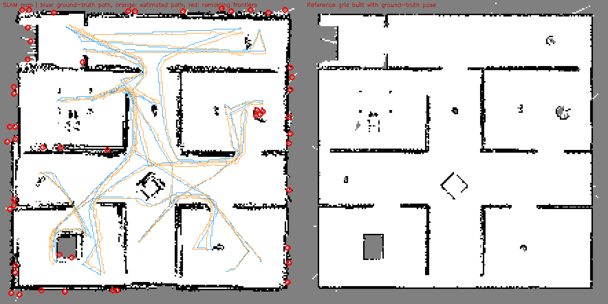

# Baseline report: run 20261113_232046

Every number comes from this run's own files. Measured = computed from telemetry or ground truth; estimate / diagnostic indicator are labelled as such; n/a = could not be measured (reason shown).

## Run identification

| Item | Value |
|---|---|
| Started | 2026-11-13T23:20:46 |
| Command | `main_agentic.py --headless --max-time 1800` |
| Code | git 1cdba5d |
| CPU / GPU | AMD Ryzen 7 7735HS with Radeon Graphics (16 threads) / NVIDIA GeForce RTX 3050 6GB Laptop GPU, 6144 MiB |
| Platform | Windows-11-10.0.26300-SP0, Python 3.12.10 |
| Configuration | `{"max_time_s": 1800.0, "max_steps": null, "grid_res_m": 0.05, "map_bounds_m": [-5.5, 5.5, -5.5, 5.5], "ground_truth_nav": false, "headless": true, "agent_rates_hz": {"PerceptionAgent": 10.0, "SLAMAgent": 10.0, "MappingAgent": 10.0, "FrontierAgent": 1.0, "PlanningAgent": 5.0, "LocomotionAgent": 20.0, "SupervisorAgent": 2.0}}` |
| Ground truth | CoppeliaSim /Base pose every control step (used for scoring only) |
| Runs in this report | 1 (no variability can be shown) |

| Source data | File | Detail |
|---|---|---|
| raw SLAM input recording | recording.npz | 387 MB, sha256 8899c2dab6699c9f... |
| per-step ground-truth and estimated pose | trajectory.csv |  |
| agent table | agents.csv |  |
| all metrics | metrics.json |  |
| run manifest | manifest.json |  |
| reference/SLAM grids, knowledge graph | artifacts |  |

## 1. Overall robot performance: what the robot achieved

| Metric | Value | Meaning |
|---|---|---|
| Outcome | mission time 1800s reached; all reachable frontiers explored at 1785s | why the run ended |
| Task success | yes | mission reported all reachable frontiers explored |
| Simulated time | 1800 s | robot time |
| Wall-clock time | 2462 s (real-time factor 0.73) | how long the computer needed; < 1 means slower than real time |
| Distance travelled | 156.9 m | path length from ground truth |
| Average speed | 0.087 m/s | distance / simulated time |
| Rooms completed / discovered | 10 / 10 | rooms the mapper segmented |
| Doorways detected | 45 | knowledge-graph entries; they accumulate as room segmentation changes, so this over-counts real doorways |
| Explored free area | 87.8 m2 | free cells x 0.05 m x 0.05 m |
| Grid observed | 81.0 % | of the 11 x 11 m map box, not of the arena |
| Stuck events / unreachable targets | 0 / 2 | watchdog and planner events |
| Human interventions | n/a (no intervention channel exists in the stack; only the 'q' key / external stop, recorded in end_reason) |  |
| Collisions | n/a (CoppeliaSim contact sensing is not wired into the stack) |  |

## 2. Agent and component performance

### 2a. Operational performance (how the agents ran, not whether they helped)

| Agent | Rate (Hz) | Calls | Errors | p50 (ms) | p95 (ms) | max (ms) | Total (s) | Share | Task metric |
|---|---|---|---|---|---|---|---|---|---|
| PerceptionAgent | 10 | 36001 | 0 | 4.19 | 8.39 | 41 | 184 | 18 % | median 575 scan pts/update |
| SLAMAgent | 10 | 36001 | 0 | 10.64 | 22.95 | 163 | 444 | 43 % | 23.8% scans matched, 84 loop closures |
| MappingAgent | 10 | 36001 | 0 | 0.58 | 3.62 | 702 | 41 | 4 % | 81.0% of grid observed |
| FrontierAgent | 1 | 3601 | 0 | 17.48 | 24.87 | 60 | 61 | 6 % | 10 rooms completed |
| PlanningAgent | 5 | 7201 | 0 | 0.43 | 8.70 | 557 | 24 | 2 % | 209 paths, 2 unreachable |
| LocomotionAgent | 20 | 36001 | 0 | 7.22 | 10.82 | 41 | 278 | 27 % | 0 stuck/watchdog events |
| SupervisorAgent | 2 | 3601 | 0 | 0.13 | 0.23 | 1 | 0 | 0 % | 255 events logged, 10 rooms in graph |

Whole control-loop step: p50 27 ms, p95 138 ms, max 1870 ms. Agent time is 1032 s of 2462 s wall time; the rest is simulator stepping, image transfer, HUD and per-step map queries outside `agent.step()` (split not measured).

### 2b. Contribution to the system result (offline replay of this run's recording, one component removed)

n/a (ablation not run: `python -m evaluation.ablate runs/<run_id>`)

## 3. Localization performance (independent of mapping)

Frame: 2D world frame of the simulator scene (x, y in m, yaw in rad). SLAM starts at the true start pose, so no trajectory alignment is applied. Evaluated at every control step (0.05 s) against simulator ground truth.

| Metric | Value | Meaning |
|---|---|---|
| ATE RMSE | 11.7 cm | typical position error over the whole run |
| ATE median / max | 11.3 / 24.5 cm |  |
| Final position error | 8.1 cm = 0.05 % of path | end-of-run drift |
| RPE translation (1 m segments) | 4.8 cm RMSE, mean 3.9 % of segment | local accuracy, independent of accumulated drift |
| RPE rotation | 1.29 deg/m |  |
| Heading error mean / max | 0.76 / 5.4 deg |  |
| Error first above 0.5 m / 1 m | n/a / n/a | n/a = never reached |
| Scan-match acceptance (diagnostic) | 23.8 % of 36000 updates | see warning in section 6 |
| Tracking-loss episodes (diagnostic) | 567 (762 s total) | >= 10 consecutive rejected updates |
| Followed by a loop closure within 30 s | 343 | relocalization proxy |
| Loop closures accepted | 84 |  |
| Odometry distance vs true | 137.2 m (-12.6 %) | diagnostic only: ground-truth path length also counts body motion the gait did not command, and the odometry-only replay in 2b has a low local error (RPE), so this is not a clean odometry scale error |

## 4. Mapping performance (independent of localization)

Reference = occupancy grid built from the same depth stream with the ground-truth pose (not an independent floor plan). Map size, coverage and accuracy are separate rows.

| Metric | Value | Meaning |
|---|---|---|
| Coverage: explored free area | 87.8 m2 | size of what was seen |
| Wall accuracy | 5.5 cm | SLAM walls to reference walls (lower is better) |
| Wall completion | 3.1 cm | reference walls to SLAM walls (lower is better) |
| Completion ratio (5 cm) | 79.5 % | reference wall cells matched within 5 cm |
| Chamfer / Hausdorff-95 | 4.3 / 15.0 cm |  |
| Precision / recall / F1 | 98.1 / 100.0 / 99.0 % | tolerance 15 cm |
| Free-space IoU | 89.3 % |  |
| Occupied cells SLAM / reference | 4483 / 2761 | more SLAM cells = thicker or smeared walls |
| Map update p50 / p95 | 0.6 / 3.6 ms |  |
| Map memory | 0.19 MB | occupancy grid |
| Frontiers remaining | 51 | unexplored boundaries left (see map_overlay.png) |

### 4b. Against the real scene (wall and object geometry read from CoppeliaSim, scoring only)

| Metric | Value | Meaning |
|---|---|---|
| Map accuracy / completion | 2.8 / 5.8 cm | mapped obstacle cells to real ones / real to mapped (mean) |
| Map precision / recall / F1 | 99.7 / 92.4 / 95.9 % | within 15 cm of a real wall or object |
| Same, map built with the true pose | accuracy 0.1 cm, recall 92.5 % | what the sensor allows with perfect localization |
| Real floor mapped as free | 94.6 % of 86.4 m2 | true coverage |
| Free space mapped outside the arena | 0.16 m2 | impossible in reality; source of phantom frontiers |
| Object detections on a real object | 21 of 97 (21.6 %) | within 0.5 m of one of 12 real objects |
| Real objects with a detection nearby | 12 of 12 | inflated by the many scattered detections |
| 'Chair' labels on the real chair | 2 of 97 (scene has 1 chair) | chair label = blob 0.18-1.05 m across |

## 5. Computational performance

| Metric | Value |
|---|---|
| Process CPU mean / p95 | 67 / 88 % (of one core; CoppeliaSim not included) |
| Memory (RSS) mean / peak | 227 / 930 MB (includes the in-memory recording buffer) |
| GPU | NVIDIA GeForce RTX 3050 6GB Laptop GPU, 6144 MiB: n/a (no code path uses the GPU (NumPy/SciPy/OpenCV on CPU); nothing to attribute) |
| SLAM tracking p50 / p95 | 10.6 / 23.0 ms |
| Largest agent by total time | SLAMAgent |
| Telemetry overhead (estimate) | 0.0056 ms/step, about 0.020 % of the median loop step |

## 6. Data quality and limitations

**Warnings**

- scan matching passed its acceptance gates on only 24 % of updates; rejection reasons are not recorded (and the flag is not refreshed for scans with <20 points), so this is a diagnostic indicator, not a failure rate

**Limitations**

- Single run: no repeatability or variance claims.
- Ground truth = CoppeliaSim body pose (exact, same timestamps; no alignment applied because SLAM starts at the GT start pose).
- Map reference = occupancy grid built from the same depth stream using the GT pose: it isolates SLAM pose error, but is limited by what the sensor saw; it is not an independent CAD floor plan.
- Simulation only: sensor noise, gait slip and lighting are simulated, not measured on hardware.

**Integrity checks** (`audit.py`)

| Check | Result | Detail |
|---|---|---|
| No ground-truth pose API in SLAM, mapping, perception, planning or odometry (static source scan) | pass | 6 files + odometry clean; gyro reads orientation delta only |
| SLAMAgent does not subscribe to pose/ground_truth in closed-loop mode | pass | subscribes to: control/actuation, sensor/scan, sensor/thumb |
| Estimated trajectory is not a copy of ground truth | pass | estimate differs from ground truth (max 24.5 cm over 36001 steps) |
| Run navigated on the SLAM pose (not ground truth) | pass | config.ground_truth_nav = False |

**Metric definitions**

- frame: 2D world frame of the CoppeliaSim scene (x, y in m, yaw in rad, CCW); SLAM initialised at the GT start pose, no trajectory alignment
- ate: per-step Euclidean position error |p_est - p_gt| over every control step; RMSE/mean/median/max
- final_drift_pct: final position error / GT path length * 100
- rpe: distance-based relative pose error over 1.0 m GT segments, relative motion in the start body frame; trans RMSE (m), mean trans error as % of segment, rot RMSE (deg/m)
- icp_acceptance: share of SLAM updates whose scan match passed the acceptance gates (else odometry-only)
- tracking_loss_episode: >= 10 consecutive rejected SLAM updates
- relocalized: tracking-loss episode followed by an accepted loop closure within 30 s
- wall_accuracy/completion: mean distance SLAM->reference occupied cells / reference->SLAM (m)
- precision/recall/f1: occupied-cell agreement with reference grid within tolerance_m
- free_space_iou: IoU of free cells between SLAM grid and reference grid
- latency: wall-clock time of each agent.step() call (ms), p50/p95/max over all calls
- real_time_factor: simulated seconds per wall-clock second

## 7. External benchmark comparison

Not yet done: added only after these measurements are verified.
